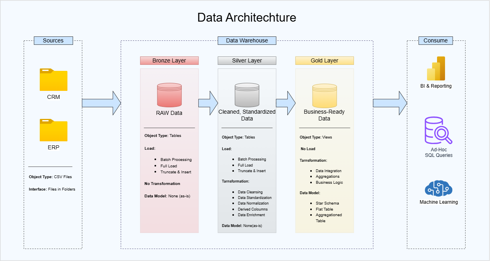

# sql-data-warehouse-project-dwh
Building a modern data warehouse with SQL Server, including ETL process, data modeling and analytics.

```
sql-data-warehouse-project/
├── setup/                    the setup guide, and the one-click Docker start for Mac
├── datasets/                 the six source files the project loads
├── docs/
├── scripts/                  the project scripts, in the order of the videos
└── tests/                    checks the quality of the silver and gold data
```

## 🏗️ Data Architecture

The data architecture for this project follows Medallion Architecture **Bronze**, **Silver**, and **Gold** layers:


1. **Bronze Layer**: Stores raw data as-is from the source systems. Data is ingested from CSV Files into SQL Server Database.
2. **Silver Layer**: This layer includes data cleansing, standardization, and normalization processes to prepare data for analysis.
3. **Gold Layer**: Houses business-ready data modeled into a star schema required for reporting and analytics.

---
## 📖 Project Overview

In this project, I:

1. **Design the architecture:** a modern data warehouse with three layers, bronze, silver and gold.
2. **Build the ETL pipelines:** load the source files and move the data through the layers.
3. **Model the data:** facts and dimensions, ready for reports.
4. **Analyze it:** answer business questions with SQL.

---

## 🛠️ Important Links & Tools

- **[Github](https://github.com/galibhasan720):** a GitHub account, to save and share your project.
- **[Notion Project Board](https://app.notion.com/p/SQL-Data-Warehouse-Project-a921501d97ab826c9a7881a1507b599f?source=copy_link):** My project plan and Progress.

---

## 🚀 Project Requirements

### Building the Data Warehouse (Data Engineering)

#### Objective
Develop a modern data warehouse using SQL Server to consolidate sales data, enabling analytical reporting and informed decision-making.

#### Specifications
- **Data Sources**: Import data from two source systems (ERP and CRM) provided as CSV files.
- **Data Quality**: Cleanse and resolve data quality issues prior to analysis.
- **Integration**: Combine both sources into a single, user-friendly data model designed for analytical queries.
- **Scope**: Focus on the latest dataset only; historization of data is not required.
- **Documentation**: Provide clear documentation of the data model to support both business stakeholders and analytics teams.

---

### BI: Analytics & Reporting (Data Analysis)

#### Objective
Develop SQL-based analytics to deliver detailed insights into:
- **Customer Behavior**
- **Product Performance**
- **Sales Trends**

These insights empower stakeholders with key business metrics, enabling strategic decision-making.  


## 🛡️ License

[MIT](LICENSE). Use it, change it, share it, with attribution.

## 🌟 About me

**Hi, I am Galib Hasan**. Student | DataAnalysis → SQL · Power BI · Python
